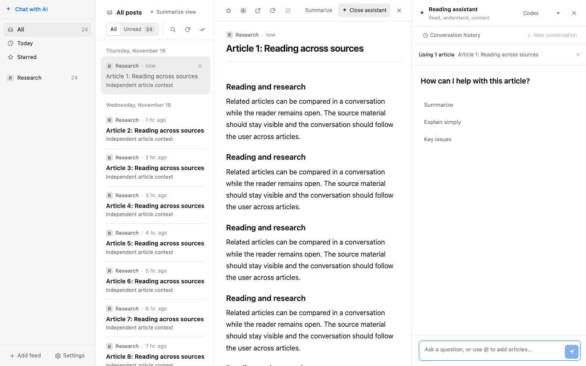

  

# Aequo

**An AI-native RSS reader that lives on your Mac.**

[Download for macOS](https://github.com/S0okJu/aequo/releases) · [Features](#read-collect-and-understand) · [Getting started](#getting-started)

  

*The reading workspace, shown with sample articles.*

Follow your favorite feeds, keep what matters, and explore what you read with AI. Aequo is a **local macOS app**: your subscriptions, articles, reading history, highlights, notes, and conversation history are stored on your device.

No Aequo account or server setup is needed. Add your feeds and start reading.

## Read, collect, and understand

- **Your feeds in one place.** Follow RSS, Atom, and JSON Feed subscriptions in a single timeline. Organize them into folders and keep track of unread articles.
- **Auto-generated feeds.** Follow websites even when they don’t offer an RSS feed. Add a website URL, and Aequo automatically discovers an existing feed or builds a feed from articles on supported pages.
- **Keep what matters.** Save articles for later, highlight passages, and add notes as you read.
- **Find it again.** Search your collected articles without leaving the app.
- **Read with AI.** Summarize an article, ask about a selected passage, or discuss several articles together. Use `@` to add a reference or `@this` to include the article you are reading.
- **Make it yours.** Choose light, dark, or system appearance, with English and Korean interface options.

## Local by default

Aequo fetches feeds directly and keeps your reading library on your Mac. You can revisit content already stored on your device while offline. Fetching new articles and content that has not been downloaded requires an internet connection.

AI is optional. You can subscribe, read, save, and annotate without connecting an AI service. When you use AI, Aequo runs your installed Codex or Claude Code CLI. Your questions and referenced article content may be sent to that provider; AI processing is handled by the connected service. An authenticated CLI and an internet connection are required, and the provider’s usage limits and pricing apply.

Your library stays on this device. Cloud sync between devices is not currently available.

## Install

Available for **macOS on Apple Silicon**.

1. Download the DMG from [GitHub Releases](https://github.com/S0okJu/aequo/releases), when available.
2. Open it and drag Aequo into Applications.
3. Launch Aequo.

Current builds are ad-hoc signed and are not notarized by Apple. If macOS blocks the first launch, attempt to open the app, then use System Settings → Privacy & Security → Open Anyway.

## Getting started

1. **Add a feed or website.** Enter a feed URL or a website address. If the site doesn’t offer a feed, Aequo can automatically build one from its article listings.
2. **Start reading.** Open an article from the timeline, save it for later, or highlight a passage and leave a note.
3. **Connect AI when you want it.** Install and sign in to Codex or Claude Code CLI, then check its connection in Aequo’s AI settings and choose your provider.
4. **Ask as you read.** Start with an article summary or a question. Add other articles with `@` to bring more context into the conversation.

## Releasing

Push a release branch such as `release/v1.0.0` and open a PR targeting `main`. CI runs tests, checks, and an Apple Silicon DMG build. After that PR is merged, the release workflow validates and builds the exact merged commit, then publishes its DMG and SHA-256 checksum to GitHub Releases. Commit messages do not control publication.

The release tag comes from the app version, not the commit message. Keep the versions in `package.json`, `src-tauri/tauri.conf.json`, `src-tauri/Cargo.toml`, and the app entry in `src-tauri/Cargo.lock` equal. The release branch version must match these versions. Bump them together for each new release; an existing version tag pointing to another commit is rejected.
